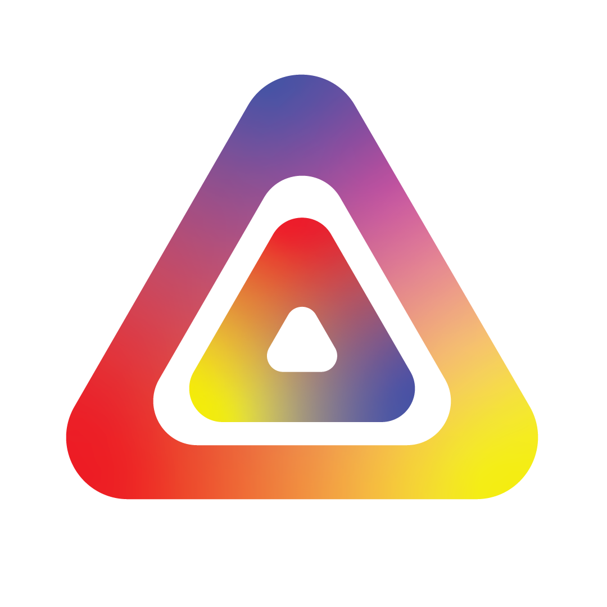
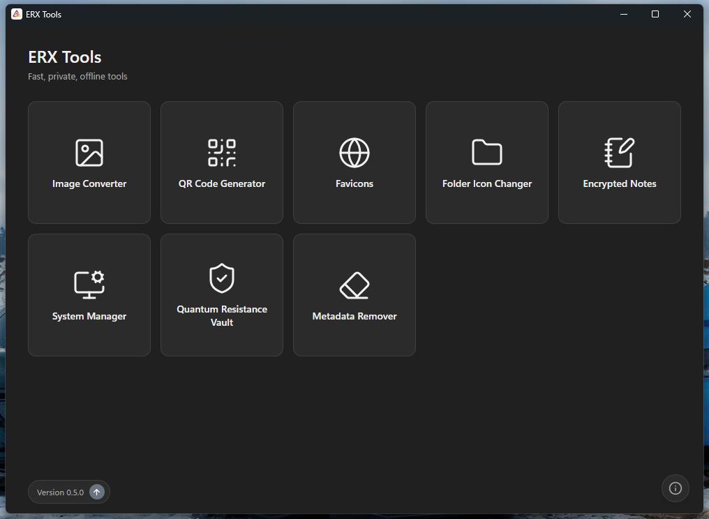
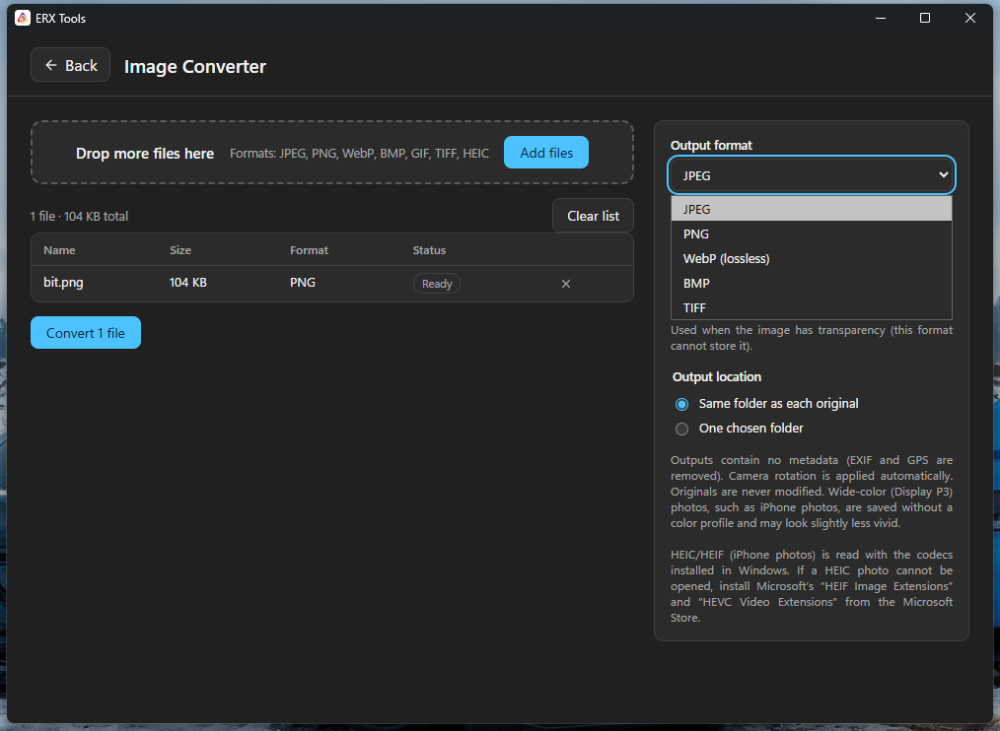
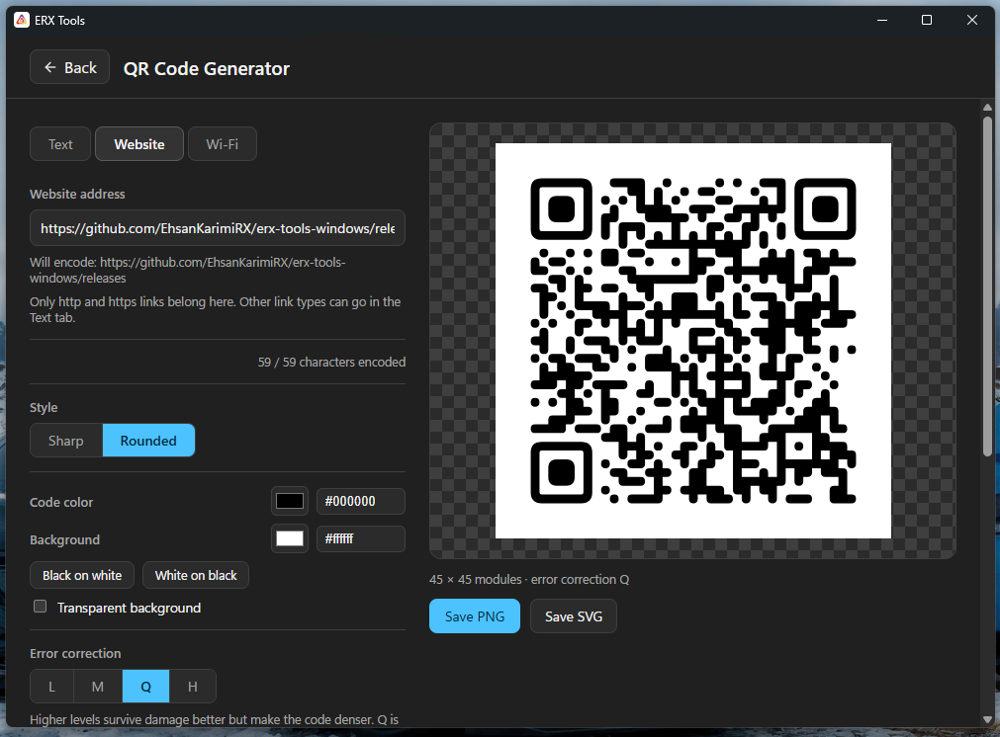
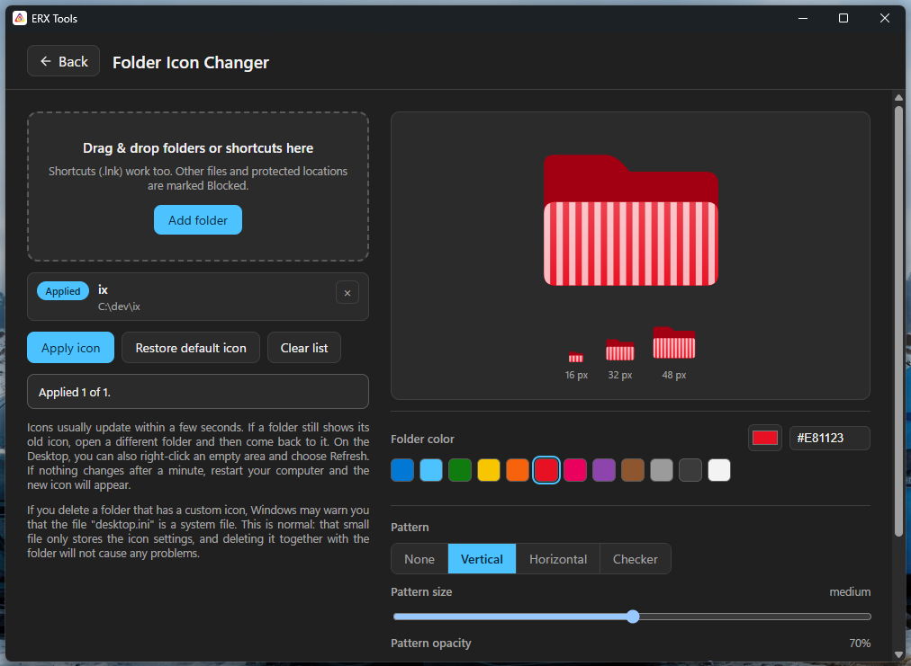
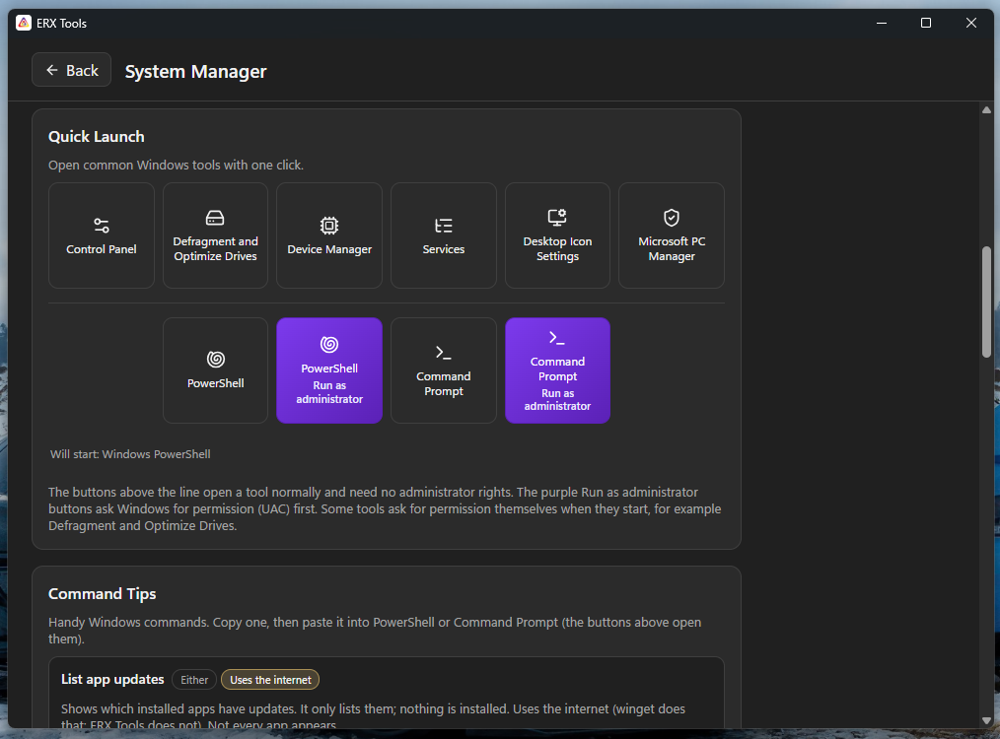
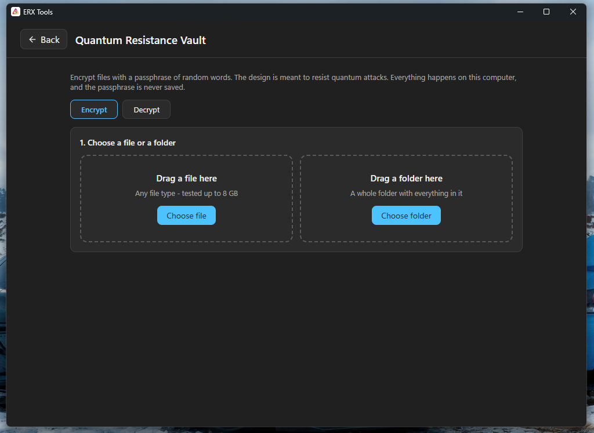
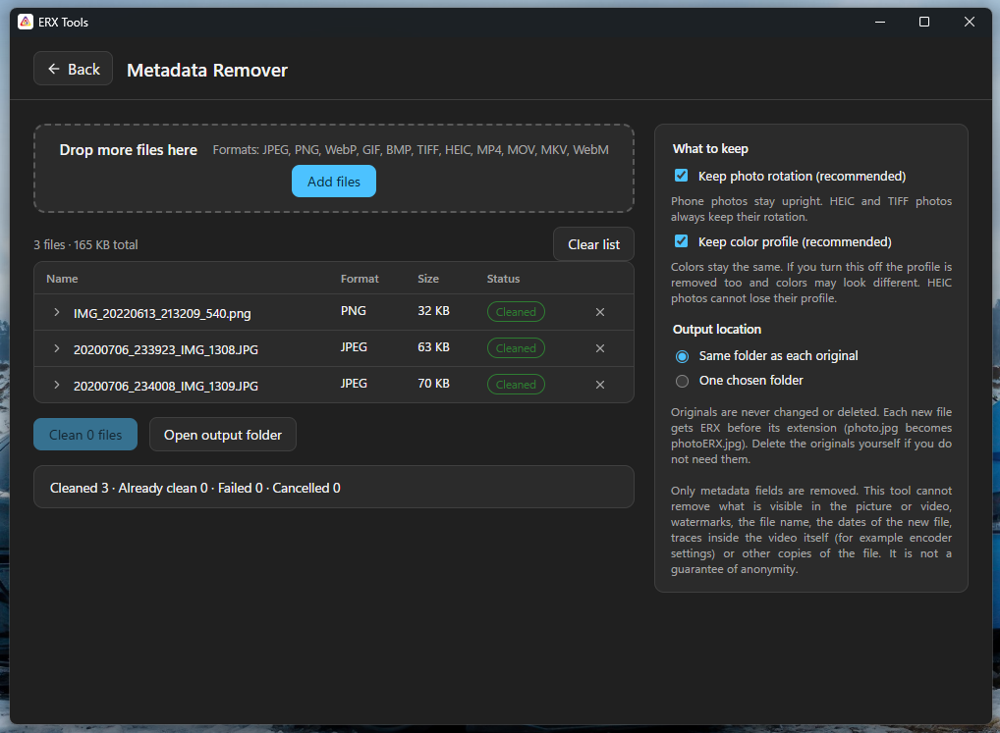

# ERX Tools

<p align="center">
  
</p>

A small, offline toolbox for Windows. Every tool opens from a simple square tile on the home screen and does one job: convert images, make QR codes, recolor folder icons, keep the PC awake, tidy up folders, encrypt files, and open common Windows tools.

> **Early beta.** ERX Tools is new and is being tested with friends. Installers are on the [Releases page](https://github.com/EhsanKarimiRX/erx-tools-windows/releases) (see [Download](#download)). So far it has only been tested on Windows 11 (see [Tested on](#tested-on)).

## Why ERX Tools

- **Offline by design.** No telemetry and no remote content. The only network request is the update check, and only when you click it (see Privacy and security).
- **No administrator rights needed.** The app does not ask for admin to run. (Some Windows tools you launch from it may ask for permission themselves.)
- **Honest results.** Batch work ends with a clear report of what succeeded, failed or was skipped, and why. No fake progress bars.
- **Careful with your files.** Originals are never modified. Output files do not overwrite existing files; the only exception is the Vault's Encrypt panel, which replaces its own output only after you tick "Replace the existing files".
- **Small and focused.** Each tool lives in its own folder and is loaded only when you open it.

## Screenshots

<p align="center">
  
</p>

## Tools

### Image Converter

<p align="center">
  
</p>

Convert images in batches (up to 200 files at a time) with live progress, cancel and a summary.
- **Input:** JPEG, PNG, WebP, BMP, GIF, TIFF and HEIC/HEIF (iPhone photos). HEIC is read with the codecs installed in Windows, so it needs Microsoft's *HEIF Image Extensions* and *HEVC Video Extensions* from the Microsoft Store (many PCs already have them). If they are missing, the app says so.
- **Output:** JPEG (with a quality slider), PNG, WebP (lossless), BMP and TIFF.
- **Output names:** every converted file gets "ERX" before the extension (photo.jpg → photoERX.png). If that name is taken it counts up (photoERX (1).png, photoERX (2).png, …), so nothing is ever overwritten.
- Camera rotation is applied automatically. Metadata (EXIF, GPS) and color profiles are not kept, so wide-color photos such as iPhone photos may look slightly less vivid. Only the first image/frame of a file is converted.

### QR Code Generator

<p align="center">
  
</p>

Create QR codes from text, links or Wi-Fi credentials. Sharp or rounded style, custom colors, optional logo in the center, export as PNG or SVG. The export size (256–4096 px, default 1080) is saved exactly as typed, the rounded style draws a rounded plate behind the logo, and Save uses a real Save dialog that always gives the file the right extension.

### Favicons
Create a complete favicon package (favicon.ico, PNG icons, Apple touch icon, Android and maskable icons, web manifest, HTML snippet) from one logo image (PNG, JPEG, WebP, BMP, GIF, TIFF, ICO or SVG).

### Folder Icon Changer

<p align="center">
  
</p>

Recolor Windows folder icons in any color, with optional stripe or checker patterns. It writes a multi-size `.ico` plus `desktop.ini` to the folders you choose and can restore the default icon. Offline, no admin rights.
- Windows shortcuts (`.lnk`) work too: drop a shortcut and its own icon is changed, without touching the shortcut's target (the icon is kept in the app's own icon folder).
- Windows usually shows a new folder icon within a few seconds. If one is late, open a different folder and then come back to it, or right-click an empty area and choose Refresh (a restart always shows it).
- Deleting a customized folder may show a Windows warning about `desktop.ini`. That is normal: the file only stores the icon settings.

### System Manager

<p align="center">
  
</p>

Everyday Windows utilities in one panel. At the top, a read-only **device card** shows your processor, graphics card, RAM, drives, Windows version and battery health (or uptime on a PC without a battery). It is read again every time System Manager opens, changes nothing and sends nothing anywhere; whatever Windows does not report is shown as "Not reported". Below it:
- **Awake** — keeps the PC from sleeping during long runs. It temporarily sets the Windows sleep, hibernate and screen-off timeouts to *Never* and puts your original values back when you turn it off. Your original values are saved to disk first, so they can be restored even after a crash. Options: let the screen turn off normally, and an optional auto-off timer. Awake only blocks *automatic* sleep; clicking Sleep or closing a laptop lid still follows Windows.
- **Quick Launch** — square one-click buttons: the six tools sit in one row. They open Control Panel, Defragment and Optimize Drives, Device Manager, Services, Desktop Icon Settings (the Windows page where you show or hide This PC, Recycle Bin and similar desktop icons) and Microsoft PC Manager (it opens the app if installed, otherwise offers its Microsoft Store page). Below a thin divider, PowerShell (PowerShell 7 if installed) and Command Prompt are available normally, and each also as a purple **Run as administrator** button that asks Windows for permission first.
- **Command Tips** — a list of handy Windows commands you can copy and run yourself. ERX Tools never runs them for you. It includes "List installed apps" and "Save installed apps to a file", which cover the classic desktop programs and the Microsoft Store apps of your Windows account (portable apps that were never installed are not listed). Long commands start collapsed and expand with a More button. It also has two commands that turn Windows' internet-connection check off and on (they need PowerShell as administrator).

### Quantum Resistance Vault

<p align="center">
  
</p>

Encrypt files and whole folders with a passphrase of random words, and decrypt them again later. Everything happens on your PC; nothing is uploaded.
- **Passphrase:** the app creates 6 to 12 random words (10 by default) from the [EFF Large Wordlist](https://www.eff.org/files/2016/07/18/eff_large_wordlist.txt). You can replace single words, and you confirm that you saved the words before encrypting. To decrypt, you type the words. There is no recovery: **if the words are lost, the files are lost.**
- **Encryption:** the data is compressed with Zstandard when that helps, then encrypted with XChaCha20-Poly1305 using a 256-bit key. The key is made from your words with Argon2id (256 MiB of memory, tuned on your PC to take about 0.7 seconds), which makes guessing the words slow. Any change to an encrypted file is detected when you decrypt it. The file format and the threat model are described in [docs/VAULT_FORMAT.md](docs/VAULT_FORMAT.md).
- **Quantum resistance:** the design uses only symmetric cryptography (no RSA or elliptic curves) and a long random passphrase, so it is designed to resist quantum computers. That is a design goal, not a promise: nobody can guarantee that encryption is unbreakable.
- **Big files:** processed as a stream, so memory use stays small (about 18 MB in our test with an 8 GB folder). The format has no practical size limit, but we tested files only up to 8 GB; larger files are untested. The result can be split into parts of 500 MB, 1 GB or 2 GB; the parts are named `name.001.erx`, `name.002.erx` and so on, so keep their names as they are. Split sets made by v0.4.1 or older (named `name.erx.001`) are not opened by this version unless you rename each part by hand (`name.erx.001` becomes `name.001.erx`, `name.erx.002` becomes `name.002.erx`, and so on) and select `name.001.erx`. Progress is live and you can cancel at any time; a cancelled run leaves no files behind.
- **Careful with your files:** the original is never changed or deleted, an existing file is replaced only if you tick "Replace the existing files" when encrypting (when you decrypt, a number is added to the name and nothing is overwritten), and the new file is read back and checked after it is written. The original file name is stored inside the encryption; the output is named `name.erx` (the file type is hidden) and the real name comes back when you decrypt.
- **Folders:** a whole folder becomes one encrypted file with its structure inside. Links and special items (devices) cannot be encrypted. A folder can hold at most 500,000 items and 64 nested levels.
- **Limits, honestly:**
  - There is no recovery and no password reset.
  - Only the file contents, the name and the folder structure are stored. File dates, attributes and permissions are not.
  - The code has had no professional security audit and the Vault is new. Keep another backup of anything you cannot replace.
  - The original stays on your disk after encrypting. Delete it yourself; a normal delete is not a secure erase.
  - An encrypted file still shows that it is an ERX file, its approximate size, how many parts there are, whether it holds a file or a folder, and whether it was compressed. File names, file types and the folder structure are hidden.
  - It cannot protect you from malware or a keylogger on your PC, or from someone who gets your words.

### Metadata Remover

<p align="center">
  
</p>

See what is hidden inside photos and videos (GPS location, camera and lens, dates, software, serial numbers, comments, thumbnails) and save a copy with that data removed. Your original is never changed or deleted; the new copy is written next to it (or into a folder you choose).
- **Input:** JPEG, PNG, WebP, GIF, BMP, TIFF, HEIC/HEIF, MP4, MOV, MKV and WebM. The type is read from the content, never from the extension. WebM is cleaned by the same Matroska engine as MKV and is shown as MKV. A BMP (and a TIFF with no hidden tags) is reported as "This file has no metadata." and no copy is made.
- **Not supported:** AVIF, M4V, audio files, Word documents, PDF, BigTIFF, TIFF files with more than one page, RAW/DNG files, and TIFF files with sub-pictures. M4V is recognized by its content (an M4V brand in the file header), not by its name. Audio, documents and PDF are answered with "not a supported photo or video file".
- **Nothing is re-encoded:** photos lose their metadata segments and chunks while their compressed picture data is copied unchanged; videos, HEIC and TIFF files are changed in place, so their size stays exactly the same. Examples: video metadata boxes become "free" boxes, Matroska Tags become "Void" elements, timed-metadata tracks (GPS, motion) are emptied together with their samples, and TIFF metadata entries are taken out of the directory and zeroed.
- **Kept by default:** the photo rotation (phone photos stay upright) and the colour profile (colours stay the same). You can turn either off; then colours may look different. HEIC always keeps its rotation and its profile, and TIFF always keeps its rotation.
- **Output names:** every new file gets "ERX" before the extension (photo.jpg → photoERX.jpg). If that name is taken it counts up (photoERX (1).jpg, …), so nothing is ever overwritten.
- **Checked before saving:** the new copy is scanned again and, for photos, its pixels are compared with the original through a hash. If a check fails the copy is not kept and the file is reported as failed. HEIC photos are compared with the Windows HEIF/HEVC codecs (the same ones the Image Converter uses); when they are missing the comparison is skipped (the result then says only that the data was copied unchanged) and the photo is still cleaned. Either way, cleaning a HEIC photo does not need those codecs.
- **Batches:** up to 200 files, two at a time, with live progress and a Cancel button that stops the running files (their temporary files are removed) and skips the rest.
- **Limits, honestly:** only metadata fields are removed. It cannot remove what is visible in the picture or video, watermarks, the file name, the dates of the new file, traces inside the video stream itself (for example an encoder name), or other copies of the file. It is not a guarantee of anonymity.
- What is removed in each format and how the safety checks work is described in [docs/METADATA_REMOVER.md](docs/METADATA_REMOVER.md).

### Secure Notes
Keep private notes in an encrypted file on your PC, opened in a hardened window that is isolated from the rest of the app and from the browser. Nothing is uploaded.
- **File:** one encrypted file per user profile folder, `secure-notes.erxnotes`, with an automatic backup (`secure-notes.erxnotes.bak`). The format is documented in [docs/NOTES_FORMAT.md](docs/NOTES_FORMAT.md).
- **Passphrase:** 5 to 12 random words from the same word list as the Vault. There is no recovery: **if the words are lost, the notes are lost.**
- **Hardened window:** Secure Notes opens in its own window with an isolated, incognito profile, no autofill, no password saving, no right-click menu, no browser shortcuts, no DevTools and screen-capture protection. The window is hidden until its settings are applied.
- **Editor:** RTL-friendly rich text with undo/redo, search by title, save indicator, auto-save every 2 seconds, and auto-lock after 10 minutes of inactivity (configurable). Copying words uses a 30-second countdown that clears the clipboard.
- **Export and restore:** export a single note as text, Markdown or an encrypted `.erxnote` file, or export the whole notebook as one encrypted backup (in Settings). For an encrypted file you choose its password: your current Secure Notes password (you type the words again) or new random words made for that file (5 to 12 words; you copy them, confirm that you saved them and type them again before the file is written). Restoring asks for the file's words, except for text files and for files made by v0.5.0. Restoring appends the notes and regenerates duplicate ids; it never replaces your existing notes. The export format is described in [docs/NOTES_FORMAT.md](docs/NOTES_FORMAT.md).
- **Export limits, honestly:** if the export words are lost, the file is lost; there is no recovery. An export made with your current password is only as strong as that password, and changing the Secure Notes password later does not change older exports (restoring one then needs the old words). Fewer than 8 export words are allowed, with a warning. Text and Markdown exports are not encrypted. The restore prompt has no limit on wrong guesses (each guess takes about one second, and the file is offline). Files exported by v0.5.0 used one fixed password built into the program, so they are effectively unprotected: v0.5.1 still opens them and asks you to export again and delete the old file, and v0.5.0 cannot open the new files. The export and restore windows do not trap the Tab key. A crash during an export can leave a `*.erxtmp` file next to the target file.
- **Settings:** preview mode (titles or first line), auto-lock minutes, and changing the passphrase (the file is re-encrypted with new words and new keys).
- **Clipboard:** words are copied by Rust code, never by the web page, and the clipboard is cleared after 30 seconds if it still holds them, and at exit.
- **Limits, honestly:** the code has had no professional security audit. Windows memory (page file, hibernation) and malware on the PC are outside its protection. After a hard kill the temporary profile folder is swept at the next start.
- **If you forget the words, there is no recovery and no reset.** To start over with an empty notebook, close ERX Tools completely (including the Secure Notes window) and delete everything in `%LOCALAPPDATA%\com.erxtools.windows\notes\` — at least `secure-notes.erxnotes`, `secure-notes.erxnotes.bak` and any `secure-notes.erxnotes.*.erxtmp`. Deleting only the main file is not enough: the backup would be loaded instead. **This permanently deletes all your notes; export a backup first if you still can.**

## About the app

The round **i** button at the bottom-right of the home screen shows the app version, a short note about the MIT License, the credit for the EFF word list used by the Vault, and a **View on GitHub** button that opens the project's GitHub page in your browser.

## Requirements

- Windows 10 or Windows 11 (x64 or ARM64).
- Microsoft Edge WebView2 Runtime (included with Windows 11 and most up-to-date Windows 10 PCs). The installer downloads it during setup only if it is missing, so that PC needs an internet connection for the setup. A PC with no WebView2 and no internet must install Microsoft's WebView2 Runtime first.
- For HEIC photos: Microsoft's HEIF Image Extensions and HEVC Video Extensions (see Image Converter).

## Tested on

| Platform | Status |
|---|---|
| Windows 11, x64 | Developed and tested by hand |
| Windows 10 | Not tested yet |
| Windows on ARM64 | The code compiles for ARM64 but has not been run there |

If something does not work on your PC, please open an [issue](https://github.com/EhsanKarimiRX/erx-tools-windows/issues) and mention your Windows version.

## Download

Download the installer for your PC from the [latest release](https://github.com/EhsanKarimiRX/erx-tools-windows/releases/latest):

| Your PC | File |
|---|---|
| Most PCs (Intel or AMD, "x64") | `ERX-Tools-<version>-x64-setup.exe` |
| Windows on ARM (for example Snapdragon laptops) | `ERX-Tools-<version>-arm64-setup.exe` |

- The installers are **not code-signed**, so Windows SmartScreen may warn you ("Windows protected your PC"): click **More info** → **Run anyway**.
- The installers are small. Setup downloads Microsoft's WebView2 Runtime only if your PC does not already have it (Windows 11 and most up-to-date Windows 10 PCs do).
- ERX Tools installs for your user account and does not need administrator rights.
- If you use **Awake**, turn it off before uninstalling, otherwise your PC's sleep settings can stay on "Never".
- Each release lists SHA-256 checksums so you can verify your download.

## Privacy and security

- The only network request ERX Tools makes is the **update check**, and only when you click the update button next to the version number on the home screen. It is one HTTPS request to GitHub asking for the latest release number. Nothing is downloaded or installed automatically, and nothing about you or your files is sent. Like any web server, GitHub can see your IP address and the app version. Everything else works offline; the app sends no telemetry and loads no remote content. The webview has a strict Content-Security-Policy and only Tauri's core default permissions.
- The UI never touches the file system directly; all file work goes through Rust commands.
- Some buttons hand off to Windows (for example opening the Microsoft Store page for PC Manager). That is Windows doing it, not ERX Tools.
- The Quantum Resistance Vault works fully offline. The passphrase words are created and kept in memory by the Rust code, not by the web page.
- The code has had no professional security audit. This matters most for the Vault; see its limits under Tools.

## Development

Prerequisites: Node.js (LTS), Rust (stable, MSVC toolchain), WebView2.

```
npm install
npm run tauri dev
```

The first Rust compile takes several minutes; later runs are fast.

Checks:

```
npm run build                 # TypeScript strict check + production frontend build
cd src-tauri
cargo fmt --check             # Rust formatting
cargo clippy -- -D warnings   # Rust lints
cargo test                    # Rust tests
```

Building the two installers (x64 and ARM64) is described in [docs/RELEASING.md](docs/RELEASING.md).

To add a tool, see [docs/ADDING_A_TOOL.md](docs/ADDING_A_TOOL.md). Design decisions are recorded in [DECISIONS.md](DECISIONS.md).

### Security rules for every change

- Never add a Tauri plugin or capability unless a tool needs it; document why.
- Never relax the CSP beyond what the app strictly needs; prefer separate `devCsp` changes for dev-mode conveniences.
- Never load remote URLs, fonts, scripts or images in the webview.
- Never expose file system, shell, http or opener permissions "just in case".
- User-facing error strings live in Rust (`ToolError`); internal details must not leak to the UI.
- Commit `package-lock.json` and `src-tauri/Cargo.lock` for reproducible builds.
- The update check (written in Rust, in the update module) is the only allowed network access. Do not add other network calls without the owner's explicit approval.

## How this project is built

ERX Tools is a product of one owner, who is not a professional programmer, built together with AI. The owner decides what to build and how it should behave. An AI consultant helps design each feature and writes detailed step-by-step specifications, and an AI coding agent writes the code from them. The owner tests every feature by hand. Automated checks run on every step: TypeScript strict mode, `rustfmt`, `clippy` with warnings as errors, and more than 750 Rust tests. The AI tools changed between releases; the Credits table below says which ones were used for which versions.

## Credits

| Who | Role |
|---|---|
| **EhsanKarimiRX** (project owner) | Idea, product design, every feature decision, requirements, hands-on testing and acceptance, and publishing. |
| **Claude Sonnet 5.5** (Anthropic), in the Claude desktop app | Consultant and prompt writer for the releases up to v0.3.0 and for v0.4.2: discussed each feature with the owner, designed the technical specifications and the step-by-step build prompts, and reviewed the agent's reports. |
| **GPT 6 Luna**, in the ChatGPT agent | Consultant and prompt writer for v0.4.0 and v0.4.1: the same role as above. |
| **GLM 5.3 Flash** (all of v0.3.0 and, by the owner's estimate, about 90% of the code of the earlier releases), **GLM 5.3** (the early stage) and **DeepSeek Flash** (about 3 to 6% of the code of the earlier releases), in Z Code (the z.ai desktop app) | The coding agents for the releases up to v0.3.0: wrote and tested the code by following those prompts. |
| **DeepSeek Flash**, in Z Code (v0.4.0 and v0.4.1) and in OpenCode (v0.4.2) | The coding agent for these releases: wrote and tested the code by following the prompts. |

So v0.4.0 and v0.4.1 were written with GPT 6 Luna as the consultant and DeepSeek Flash as the coding agent. v0.4.2 was written with Claude Sonnet 5.5 as the consultant and DeepSeek Flash as the coding agent.

Built with [Tauri 2](https://tauri.app/), [React](https://react.dev/), TypeScript and Rust.

## Name and logo

The source code is released under the MIT License (see below). The **ERX Tools** name, the ERX Tools **logo** (the files in the `branding/` folder, `src/assets/erx-logo.png` and the app icons) and the ERX Tools **wallpaper** (`src-tauri/assets/erx-wallpaper.jpg`) are **not** covered by that license; they were made for the project and remain the project owner's. You are welcome to fork the code and change it, but please give your version its own name, its own logo and its own wallpaper, and do not present it as the official ERX Tools. Details: [branding/NOTICE.md](branding/NOTICE.md).

## License

The source code is released under the [MIT License](LICENSE). The name and logo are not part of that license (see [Name and logo](#name-and-logo)).
Third-party components and their licenses are listed in [THIRD_PARTY_LICENSES.md](THIRD_PARTY_LICENSES.md).
